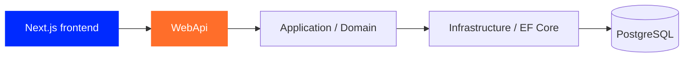

<div align="center">

# Treba Backend

### API маркетплейсу · дані · автентифікація

[English](README.en.md) · **Українська**


<br>

   

[](https://github.com/tr3ba/treba-backend)
[](https://github.com/tr3ba/treba-frontend)
[](https://github.com/tr3ba/.github/blob/main/README.uk.md)

</div>

## Навігація

[Огляд](#backend-about) · [Технології](#backend-stack) · [Структура](#backend-structure) · [Запуск](#backend-run) · [Перевірки](#backend-checks) · [Docker і доставка](#backend-delivery) · [Документація](#backend-docs)

---

<a id="backend-about"></a>

## Що робить backend

Treba Backend: серверна частина командного маркетплейсу. API працює з каталогом, користувачами, продавцями, магазинами, кошиком, замовленнями та адміністративними операціями.

<table width="100%">
<tr>
<td width="460" valign="top">

### Маркетплейс

- Товари, категорії, бренди та атрибути.
- Варіанти, зображення й теги товарів.
- Продавці, магазини та заявки продавців.
- Кошик, список бажань, замовлення й відгуки.
- Імпорт товарів, підтримка та сповіщення.

</td>
<td width="460" valign="top">

### Облікові записи та операції

- Реєстрація з верифікацією email/SMS.
- Login, refresh/logout і перевірки 2FA.
- Відновлення пароля та зовнішня авторизація.
- Адміністративні API й правила доступу.
- Інтеграції доставки та Telegram Mini App.

</td>
</tr>
</table>

Зовнішні інтеграції потребують окремого налаштування. Адміністративний інтерфейс працює у frontend на `/admin`. [Як його перенесли](https://github.com/tr3ba/treba-backend/blob/37bb801ba1aee85719ac49d61151840071b59e85/docs/admin-frontend-migration.md).

<a id="backend-stack"></a>

## Технології та версії

| Компонент | Версія або налаштування |
|---|---|
| Мова | C#; окремий номер версії мови тут не заявляється |
| Платформа | ASP.NET Core / .NET 10, `net10.0` |
| Entity Framework Core | Пакети Design/Tools `10.0.11` |
| PostgreSQL provider | `Npgsql.EntityFrameworkCore.PostgreSQL 10.0.3` |
| JWT Bearer | `10.0.12` |
| Хешування паролів | `BCrypt.Net-Next 4.2.0` |
| Swagger | `Swashbuckle.AspNetCore 10.2.3` |
| Локальна й CI база | `postgres:18-alpine` у Compose та Backend Build |
| Контейнери | .NET SDK 10.0 → ASP.NET runtime 10.0 |

Конфігурація: [WebApi.csproj](https://github.com/tr3ba/treba-backend/blob/37bb801ba1aee85719ac49d61151840071b59e85/src/Rozetka-clone/WebApi/WebApi.csproj), [Infrastructure.csproj](https://github.com/tr3ba/treba-backend/blob/37bb801ba1aee85719ac49d61151840071b59e85/src/Rozetka-clone/Infrastructure/Infrastructure.csproj), [Dockerfile](https://github.com/tr3ba/treba-backend/blob/37bb801ba1aee85719ac49d61151840071b59e85/docker/Dockerfile.backend), [Compose](https://github.com/tr3ba/treba-backend/blob/37bb801ba1aee85719ac49d61151840071b59e85/docker-compose.yml).

<a id="backend-structure"></a>

## Структура рішення

```text
src/Rozetka-clone/
├── Application/       прикладні сервіси та сценарії
├── Contracts/         спільні контракти
├── Domain/            доменні сутності
├── Infrastructure/    EF Core, persistence та інтеграції
├── WebApi/            HTTP API й налаштування застосунку
└── WebApi.Tests/      тести
```

`Shared/` містить спільні допоміжні файли, які також використовуються під час збірки WebApi. Рішення: `src/Rozetka-clone/Rozetka-clone.sln`.



<a id="backend-run"></a>

## Локальний запуск вихідного коду

Наведені команди виконуються в корені **tr3ba/treba-backend**.

### 1. Підготувати середовище

Потрібні .NET SDK 10, PostgreSQL і налаштовані параметри Development. Без рядка підключення та коректних ключів запуск не буде повним.

| Конфігурація .NET | Для чого / вимога |
|---|---|
| `ConnectionStrings:DefaultConnection` | Підключення до окремої локальної PostgreSQL БД |
| `Jwt:SecretKey` | Не менше 32 байтів UTF-8 |
| `Jwt:Issuer`, `Jwt:Audience` | Значення видавця й аудиторії токенів |
| `Security:EncryptionKey` | Base64-кодування рівно 32 байтів |
| `Security:OtpHashKey` | Base64-кодування щонайменше 32 байтів |
| `ApplyMigrations` | Умовне застосування EF-міграцій під час startup |

Для environment variables двокрапка замінюється на `__`, наприклад `ConnectionStrings__DefaultConnection`. Можна використовувати .NET User Secrets для WebApi або локальний `appsettings.Development.json`, підготовлений за [прикладом](https://github.com/tr3ba/treba-backend/blob/37bb801ba1aee85719ac49d61151840071b59e85/src/Rozetka-clone/WebApi/appsettings.Development.example.json). Шаблон потребує заповнення значень.

Файл `.env.example` у корені стосується Compose; `dotnet run` сам по собі не означає завантаження цього файла. Вимоги ключів визначені у [DependencyInjection.cs](https://github.com/tr3ba/treba-backend/blob/37bb801ba1aee85719ac49d61151840071b59e85/src/Rozetka-clone/Infrastructure/DependencyInjection.cs) і [Program.cs](https://github.com/tr3ba/treba-backend/blob/37bb801ba1aee85719ac49d61151840071b59e85/src/Rozetka-clone/WebApi/Program.cs).

### 2. Підготувати базу

Створіть локальну БД і налаштуйте рядок підключення. У Development-прикладі `ApplyMigrations=true`; у Program.cs міграції запускаються лише коли цей прапорець увімкнено. Загальні startup-міграції призначайте тільки підготовленій локальній БД; production має окремі операційні процедури.

### 3. Відновити пакети й запустити

Приклад для PowerShell:

```powershell
dotnet restore src/Rozetka-clone/Rozetka-clone.sln
$env:ASPNETCORE_ENVIRONMENT = "Development"
dotnet run --project src/Rozetka-clone/WebApi/WebApi.csproj --no-launch-profile -- --urls http://localhost:5000
```

Swagger вмикається лише в Development. Створення administrator, email/SMS, OAuth, Нова Пошта й Telegram потребують відповідної конфігурації; один успішний startup не перевіряє ці сценарії.

### Health endpoints

| Запит | Що він показує |
|---|---|
| `GET /ping` | Процес відповідає; endpoint не потребує підключення до БД |
| `GET /health` | Виконується `CanConnectAsync` до PostgreSQL; успіх не перевіряє всю схему й бізнес-сценарії |

```powershell
Invoke-RestMethod http://localhost:5000/ping
Invoke-RestMethod http://localhost:5000/health
```

<a id="backend-checks"></a>

## Збірка та тести

```powershell
dotnet build src/Rozetka-clone/Rozetka-clone.sln --configuration Release
dotnet test src/Rozetka-clone/WebApi.Tests/WebApi.Tests.csproj --configuration Release
dotnet list src/Rozetka-clone/Rozetka-clone.sln package --vulnerable --include-transitive
```

Для PostgreSQL integration tests потрібен `TREBA_TEST_POSTGRES` із рядком підключення до окремої тестової БД. Без цієї змінної частина PostgreSQL-тестів пропускається. [Backend Build](https://github.com/tr3ba/treba-backend/blob/37bb801ba1aee85719ac49d61151840071b59e85/.github/workflows/build-backend.yml) піднімає PostgreSQL 18 і передає цю змінну тестам.


<a id="backend-delivery"></a>

## Docker і доставка

```powershell
docker build -f docker/Dockerfile.backend -t treba-backend:local .
```

Dockerfile публікує WebApi, використовує ASP.NET runtime 10.0 та слухає порт 5000. Для запуску контейнера потрібна runtime-конфігурація з таблиці вище; сама збірка образу не створює БД.

<details>
<summary><strong>Compose та Kubernetes Stage 5</strong></summary>

Compose описує PostgreSQL, backend і frontend; frontend збирається із сусіднього `../treba-frontend`. У конфігурації вже є `Jwt__SecretKey` та healthcheck `/health`.

Для запуску Compose потрібні коректні міграції, ключі й параметри frontend build. `NEXT_PUBLIC_*` у Dockerfile задаються під час збірки, тоді як Compose передає відповідні значення під час запуску.

У `k8s/` зберігається окрема локальна конфігурація Stage 5. YAML check перевіряє синтаксис маніфестів.

</details>

### Шлях CI/CD

```text
Backend Build / тести
        ↓
Docker build → /ping та перевірки ресурсів → Amazon ECR
        ↓
AWS Systems Manager → candidate → EC2 / HTTP-перевірки
```

Deployment-скрипт вибирає образ за SHA-тегом, перевіряє новий контейнер і зберігає попередній для повернення при помилці. Повернення контейнера не відкочує міграції БД.

[Workflows](https://github.com/tr3ba/treba-backend/blob/37bb801ba1aee85719ac49d61151840071b59e85/.github/workflows/deploy-backend.yml) · [Deployment script](https://github.com/tr3ba/treba-backend/blob/37bb801ba1aee85719ac49d61151840071b59e85/scripts/server/deploy-telegram-backend.sh)

<details>
<summary><strong>Перед production-запуском</strong></summary>

- `MockPaymentProvider` реєструється лише в Development. Для non-Development у `AddInfrastructure` потрібна реалізація `IPaymentProvider`; без неї production-платежі не працюватимуть.
- `IDeliveryProvider` тут прив'язаний до `MockDeliveryProvider`. Інтеграції Нової Пошти описані окремо в документації доставки.

Реєстрація провайдерів: [DependencyInjection.cs](https://github.com/tr3ba/treba-backend/blob/37bb801ba1aee85719ac49d61151840071b59e85/src/Rozetka-clone/Infrastructure/DependencyInjection.cs).

</details>

<a id="backend-docs"></a>

## Документація за напрямами

| Напрям | Документ у вихідному репозиторії |
|---|---|
| Admin UI → frontend | [Перенесення адміністративного простору](https://github.com/tr3ba/treba-backend/blob/37bb801ba1aee85719ac49d61151840071b59e85/docs/admin-frontend-migration.md) |
| Реєстрація та відновлення | [Верифікація](https://github.com/tr3ba/treba-backend/blob/37bb801ba1aee85719ac49d61151840071b59e85/docs/registration-verification.md) · [Password reset](https://github.com/tr3ba/treba-backend/blob/37bb801ba1aee85719ac49d61151840071b59e85/docs/password-reset.md) |
| OAuth | [Google / Facebook](https://github.com/tr3ba/treba-backend/blob/37bb801ba1aee85719ac49d61151840071b59e85/docs/external-authentication.md) |
| Доставка | [Нова Пошта та сповіщення](https://github.com/tr3ba/treba-backend/blob/37bb801ba1aee85719ac49d61151840071b59e85/docs/delivery-notifications.md) |
| Імпорт | [Seller product import](https://github.com/tr3ba/treba-backend/blob/37bb801ba1aee85719ac49d61151840071b59e85/docs/seller-product-import.md) |
| Підтримка | [Приватні розмови](https://github.com/tr3ba/treba-backend/blob/37bb801ba1aee85719ac49d61151840071b59e85/docs/support-conversations.md) |
| Локальний launcher | [Інструкція](https://github.com/tr3ba/treba-backend/blob/37bb801ba1aee85719ac49d61151840071b59e85/docs/local-launcher.md) |


---

[Frontend README](https://github.com/tr3ba/treba-frontend#readme) · [Історія TREBA](https://github.com/tr3ba/.github/blob/main/docs/history/project-history.md) · [Команда](https://github.com/tr3ba/.github/blob/main/docs/team/README.md)
