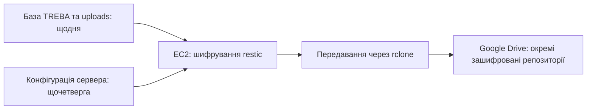

# Резервні копії TREBA та відновлення

Документ описує налаштовану DevOps-схему за результатами перевірок 12–14 листопада 2026 року.
Поточний стан перевіряється на EC2 командами нижче; дата документа не замінює свіжої перевірки.

## Що і коли копіюється

- **Щодня о 03:00 Europe/Kyiv:** повний логічний дамп бази TREBA та файли uploads.
  Це схема й дані однієї бази, а не копія всього RDS-інстансу чи його глобальних ролей.
- **Щочетверга о 04:00 Europe/Kyiv:** вибрана серверна конфігурація,
  службові DevOps-файли, відомості про встановлені пакети та посилання на образи.
- Обидва розклади запускаються через systemd. Пропущений запуск виконується після ввімкнення EC2.
- Копії шифрує restic; rclone передає їх у Google Drive. Для даних і конфігурації використовуються окремі restic-репозиторії.
- Завдання узгоджуються через спільний lock `/opt/treba-backup/backup.lock`.



Для даних налаштовано зберігання останніх **7 щоденних і 4 щотижневих періодів**.
Одна копія може задовольняти обидва правила, тому це не обов'язково 11 різних копій.
Для серверної конфігурації зберігаються **останні 4 копії**; ручні запуски теж впливають на цю історію.
Очищення виконується службовими завданнями разом із перевірками репозиторію.
Не видаляйте окремі файли restic-репозиторію через інтерфейс Google Drive.

## Зв'язок з оновленнями ОС

Після успішного серверного бекапу `OnSuccess` запускає `treba-post-backup-update.service`.
Ланцюг «бекап → перевірка → оновлення» пройшов контрольний запуск 13 листопада.
Автоматичне перезавантаження вимкнене.

**Ручний запуск серверного бекапу також може запустити цей ланцюг.**
Для перегляду стану використовуйте команди читання нижче, а не `systemctl start`.

## Перевірка стану на EC2

Імена служб пишуться латиницею. Блок лише читає стан і вибрані поля звітів:
він не запускає бекап, оновлення, очищення чи відновлення.

```bash
sudo env TZ=Europe/Kyiv systemctl list-timers --all --no-pager \
  treba-backup.timer treba-server-backup.timer

sudo systemctl show --no-pager \
  treba-backup.service treba-server-backup.service treba-post-backup-update.service \
  -p Id -p ActiveState -p SubState -p Result -p ExecMainStatus \
  -p ExecMainStartTimestamp -p ExecMainExitTimestamp

sudo python3 -I - <<'TREBA_BACKUP_STATUS'
import json
from pathlib import Path

root = Path("/opt/treba-backup")
fields = (
    "snapshot_id", "verified_utc", "files_verified",
    "database_restore_test", "file_restore_test",
    "full_server_rebuild_test",
)
for relative in ("last-backup.json", "server/last-backup.json"):
    path = root / relative
    print("\nREPORT: " + relative)
    if not path.is_file():
        print("REPORT_MISSING")
        continue
    report = json.loads(path.read_text())
    for key in fields:
        if key in report:
            print(key + ": " + str(report[key]))
TREBA_BACKUP_STATUS
```

Для завершеного oneshot-завдання нормальний стан — `inactive`, `Result=success`,
`ExecMainStatus=0`, із часом завершення та актуальним звітом.
`activating` означає, що робота триває: `Result=success` або старий JSON самі по собі не підтверджують завершення нового запуску.

`database_restore_test=pending` у новому звіті означає, що саме цей дамп ще не перевірено
відновленням у PostgreSQL. Перевірка завантажених файлів і хешів не замінює відновлення бази.

## Що вже перевірено

- Копіювання, завантаження назад, розшифрування та перевірка файлів даних і серверної конфігурації пройшли.
- Відновлення бази з Google Drive перевірено в ізольованому PostgreSQL 18; відновлено 71 таблицю.
- 14 листопада на ізольованій копії також пройшла репетиція трьох нових backend-міграцій.
  Робоча база й робочі контейнери під час цієї репетиції не змінювалися.
- Автоматичний щоденний запуск і політика зберігання пройшли перевірку.
- **Повне відтворення EC2 на новому сервері ще не перевірене.**

Серверна копія є набором конфігураційних файлів та метаданих.
Вона не є повним EBS snapshot і не містить автоматично всі Docker-образи.
Окремий зашифрований архів історичних образів не замінює резервну копію бази;
його перевірка через `docker load` ще не виконувалася.

## Порядок відновлення

1. Отримати окремо збережений пароль restic і доступ до потрібного Google-акаунта.
2. На окремій машині відкрити потрібний репозиторій та обрати конкретний snapshot.
3. Відновити файли в тимчасовий приватний каталог і перевірити їх до застосування.
4. Дамп бази спочатку відновити в ізольований PostgreSQL сумісної версії; перевірити структуру й дані.
5. Для заміни EC2 відтворити Docker, мережі, служби та конфігурацію за збереженими метаданими.
   Отримати потрібні образи за зафіксованими digest.
6. Перемикати робочий сервіс лише після окремого погодження, з перевіркою HTTPS,
   приватних портів, IMDS-захисту та стану бекапів.

Робочі recovery-команди не запускаються автоматично з GitHub Actions або цього документа.
Скрипти, реально встановлені на EC2, потрібно окремо звірити перед перенесенням їхнього коду в репозиторій.

## Доступ і обмеження

- Пароль restic, `rclone.conf`, OAuth-токени, env-файли та дампи бази не додаються в Git.
  Пароль від копій уже збережено окремо; його втрата унеможливить розшифрування.
- У використаному Google-акаунті доступний загальний ліміт 15 ГіБ.
  Заповнення перевіряється окремо; зберігання старих образів також займає цю квоту.
- Google OAuth-додаток налаштовувався в режимі **Testing**. Для дозволу Drive
  refresh token у цьому режимі має строк дії 7 днів; без повторної авторизації
  подальші бекапи можуть перестати працювати.
  Поточний статус публікації додатка тут повторно не перевірявся.
- Поточні локальні uploads входять у копії. Після фактичного переходу backend на S3
  необхідно окремо перевірити охоплення нових медіа; підготовлений S3-бакет сам цього не гарантує.

Джерела для поведінки інструментів:
[політика зберігання restic](https://restic.readthedocs.io/en/stable/060_forget.html),
[строки дії Google OAuth-токенів](https://developers.google.com/identity/protocols/oauth2#expiration).
